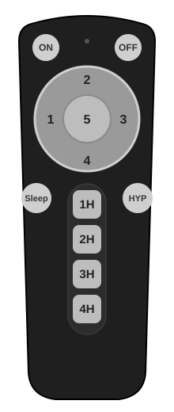

# Fan RF Remote — 3× Crompton Fans via ESP32-C3 + CC1101

DIY 433.92 MHz RF bridge for three Crompton BLDC ceiling fans, controlled from Home Assistant.

```
┌──────────────────────┐        ┌───────────────────────┐
│  Home Assistant      │  WiFi  │  ESP32-C3 Super Mini  │
│  (Podman in LXC)     │◄──────►│  ESPHome 2026.11.0    │
│  • Fan Remotes dash  │        │  • CC1101 @ 433.92MHz │
│  • Fan 1/2/3 entities│        │  • 39 RF buttons      │
└──────────────────────┘        └───────────┬───────────┘
                                             │ SPI + GDO
                                     ┌───────▼───────┐
                                     │  CC1101 SMA   │──► 433 MHz antenna
                                     └───────────────┘
```

## What this repo contains

| Path | Description |
|---|---|
| `esphome/rf-fan-remote.yaml` | The live ESPHome firmware (3 remotes × 13 buttons + 3 fan entities) |
| `esphome/secrets.example.yaml` | Secrets template (Wi-Fi creds redacted) |
| `docs/captured_codes.md` | All 39 captured RF codes (raw µs pulse lists) |
| `docs/fans_remote.yaml` | HA Lovelace dashboard (SVG remote + button grid) |
| `docs/hass-configuration-snippet.yaml` | `lovelace.dashboards` registration snippet |
| `docs/automations_remote_sync.yaml` | HA automation matching physical remote presses (`esphome.rf_fan_remote_press` event) against the 39 captured codes and syncing fan entities (loop-safe via `rf_suppress`) |
| `docs/gen_remote_sync_automation.py` | Regenerates the automation table from the firmware's own code arrays |
| `docs/remote-to-ha-sync-design.md` | Design notes for the physical-remote → HA sync feature |
| `diagrams/fan_remote.svg` | Remote panel graphic used by the dashboard |

---

## Hardware & wiring

| CC1101 | ESP32-C3 Super Mini | Notes |
|---|---:|---|
| VCC | 3V3 | **never 5V** |
| GND | GND | |
| SCK | GPIO4 | SPI clock |
| MISO (SO) | GPIO5 | SPI MISO |
| MOSI (SI) | GPIO6 | SPI MOSI |
| CSN | GPIO7 | SPI chip-select |
| GDO0 | GPIO3 | **TX** (dual-pin mode) |
| GDO2 | GPIO10 | **RX** (dual-pin mode) |

Avoid GPIO2/8/9. Dual-pin mode (GDO0 → TX, GDO2 → RX) is used — NOT single-pin.



---

## Phase 1 — ESPHome dashboard container (HA LXC)

```bash
mkdir -p /opt/esphome
podman run -d --name esphome --restart unless-stopped --net=host \
  -v /opt/esphome:/config:Z ghcr.io/esphome/esphome:latest
# dashboard: http://<HA_LXC_IP>:6052
```

`secrets.yaml`:

```yaml
wifi_ssid: "YOUR_SSID"
wifi_password: "YOUR_PASSWORD"
```

---

## Phase 2 – 4 — Sniffer → capture → final firmware

See `docs/captured_codes.md` for the full captured table and the general workflow:

1. Sniffer firmware: `dump: all` + raw logging, CC1101 on 433.92 MHz, filter BW ~540 kHz.
2. Press each remote button 2–3× (10–30 cm), 10–30 cm from the antenna.
3. Verify codes are **fixed** (non-rolling) — all three remotes here are fixed.
4. Encode as `remote_transmitter.transmit_raw` (raw µs lists; proprietary OOK, not RCSwitch).

Key build notes:

- **RMT buffer:** ESP32-C3 TX needs `rmt_symbols: 96` (65-pulse codes > default 48). `use_dma` is NOT available on C3.
- **Boot silence:** `on_boot` drives TX pin low → `cc1101.set_idle` → `begin_rx`; first RF write after boot is suppressed.
- **Dedupe:** fan output only transmits when the requested level actually changes (kills double-beep).
- **OTA:** if upload resets, kill all concurrent log/API sessions and wait ~60 s for stale sockets (device saturates its 20-connection API limit).

---

## Phase 5 — Home Assistant: Fan Remotes dashboard

### 1. Register the YAML dashboard (HA 2026.x)

Add to `configuration.yaml`:

```yaml
lovelace:
  dashboards:
    fan-remotes:
      mode: yaml
      title: Fan Remotes
      icon: mdi:fan
      show_in_sidebar: true
      filename: dashboards/fans_remote.yaml
```

Restart Home Assistant. The sidebar shows **Fan Remotes**.

> Note: in HA 2026, YAML dashboards are **not** created via the “Add Dashboard” UI — they must be registered in `configuration.yaml` as above. Dashboard URL keys must contain a hyphen (`fan-remotes`, not `fans`).

### 2. Dashboard file

`docs/fans_remote.yaml` (also live at `config/dashboards/fans_remote.yaml`) shows per fan:

- `entities` card (fan entity: toggle + speed slider)
- remote SVG (`/local/remotes/fan_remote.svg` → serve from `config/www/remotes/fan_remote.svg`)
- 4-column button grid (ON/OFF/1–5/Sleep/HYP/1H–4H)

### 3. Loop-safe architecture (button ↔ fan entity)

| Input | Path | Result |
|---|---|---|
| Dashboard button | ESPHome button `on_press` → script → `transmit_raw` | one RF burst |
| Fan entity slider/toggle | template output `write_action` → dedupe → script | one RF burst |
| Boot / HA restore | first write suppressed + dedupe | silent |

No HA automations are required (they caused the echo/double-beep loop and were removed).

### 4. Internet/phone access

Use the HA app; open the **Fan Remotes** dashboard.

---

## Troubleshooting highlights

| Symptom | Cause / fix |
|---|---|
| Device “unavailable” in HA | Device rebooted or WiFi down; wait for reconnect; API saturates at 20 conns — close other tools |
| OTA connection reset | Stale sockets; kill log watchers, wait 60 s, retry `esphome upload --device <IP>` |
| Double beep on press | Remove HA automations echoing button→fan; use dedupe in output |
| Fans beep at power-up | Boot glitch — handled by `on_boot` idle + first-write suppression |
| Dashboard “Entity not found” | Dashboard references old entity IDs after firmware rename — use current IDs (`fan_1_on`, `fan_1_1`, …) |
| No RF at all | Check CC1101 wiring / `Chip ID 0x0014` in logs; avoid 5V on VCC |

---

## Physical remote → HA sync (RF RX)

The CC1101 RX path (GDO2 → GPIO10) is used to listen for physical remote presses:

1. Firmware `remote_receiver.on_raw` publishes an `esphome.rf_fan_remote_press` event (raw µs pulses).
2. HA automation `RF Fan Remote · physical remote sync` (see `docs/automations_remote_sync.yaml`) normalizes the pulses (S/L) and matches against the 39 captured codes.
3. On match it updates the fan entity with `rf_suppress` ON — so **no RF is re-transmitted** (no echo/double-beep). Sleep/HYP/timer presses are recorded to `input_text.fan_last_remote_command`.

The matching table is generated from the firmware's own code arrays (`docs/gen_remote_sync_automation.py`) so firmware and HA never drift apart.

## Backup

- `/opt/esphome` (configs + build) is the primary ESPHome folder.
- `configuration.yaml` / `.storage/` under the HA config volume are the HA backups (copy before edits).

License: MIT (documentation for personal use; not affiliated with Crompton).
